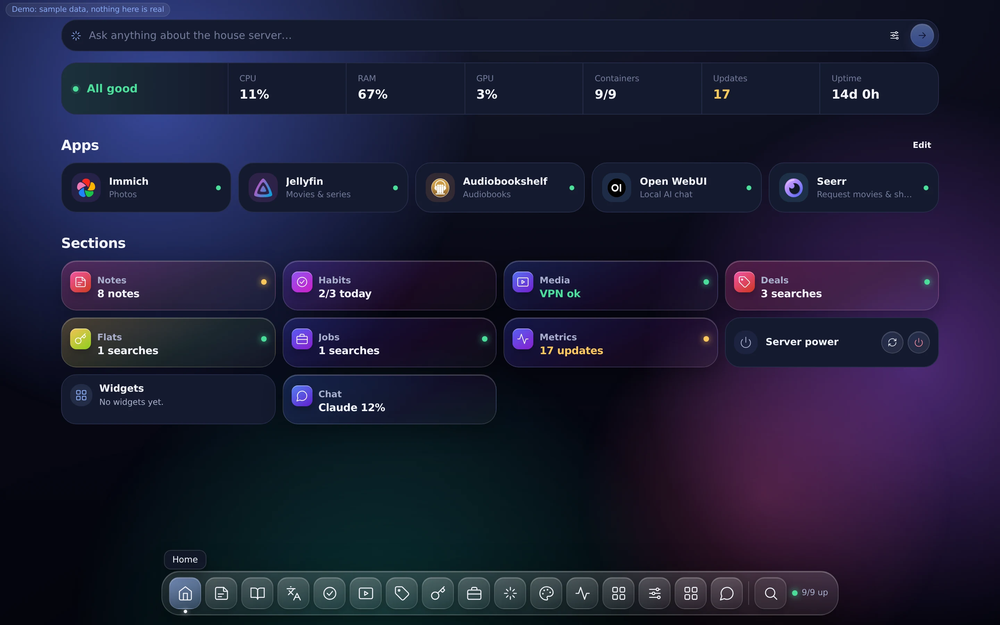
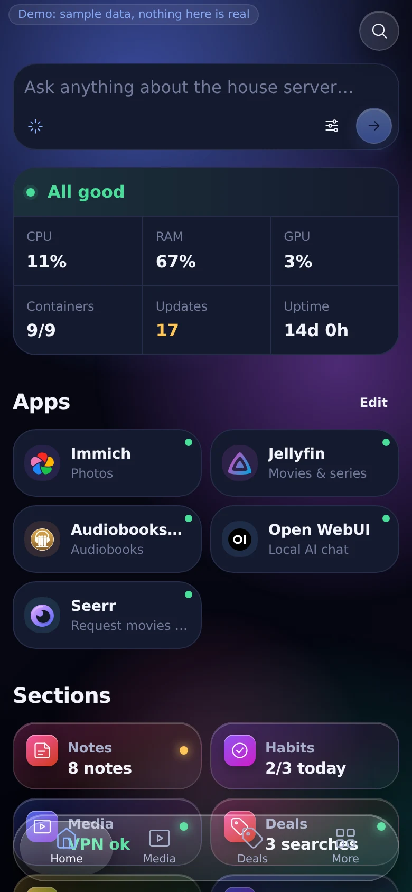
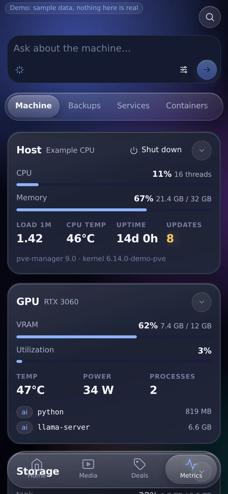
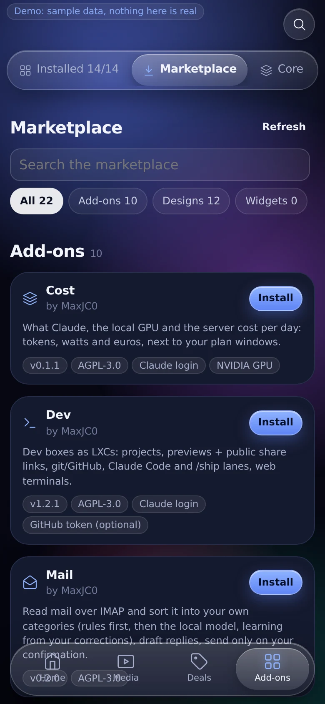
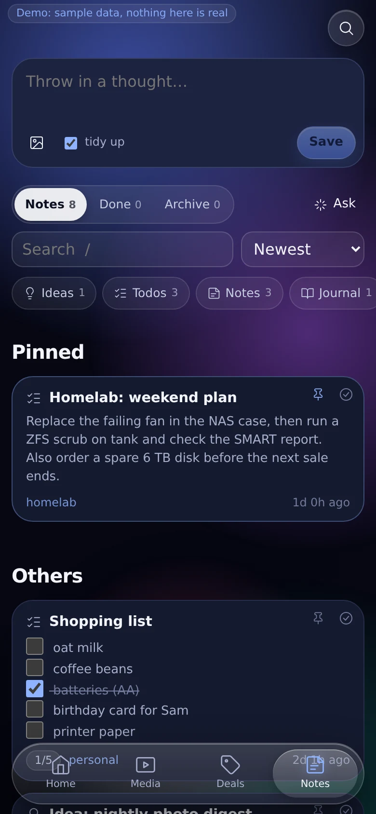
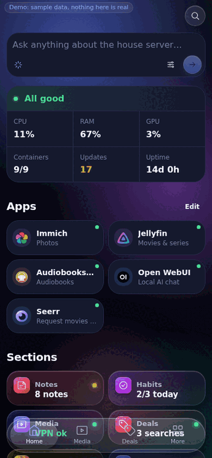
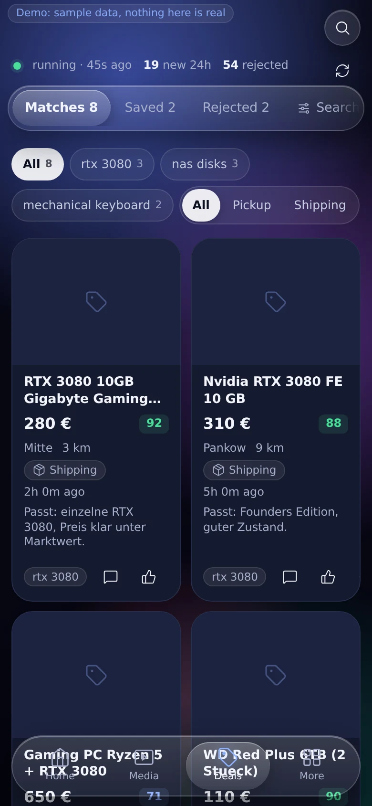
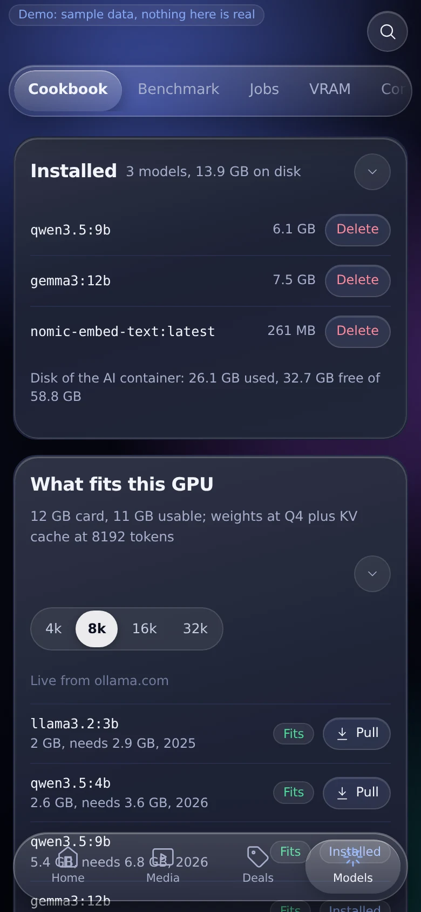
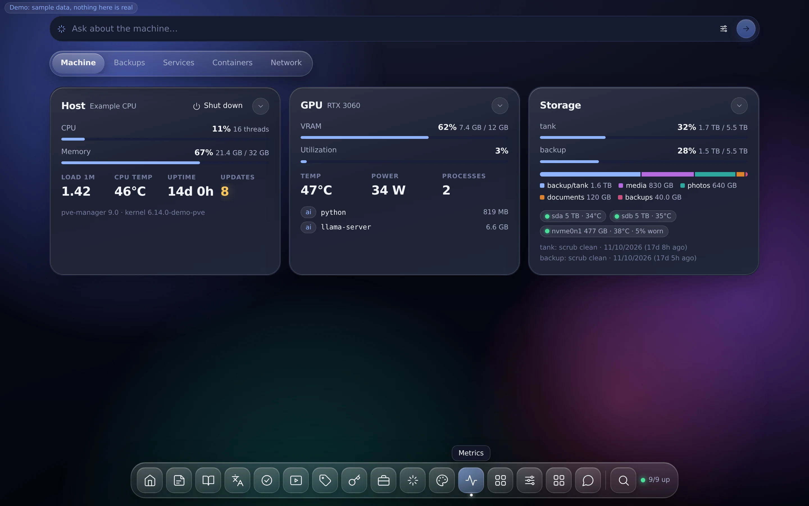

# Bastion

**A self-hosted, phone-first control panel for your home server.** Bastion shows what your machine is doing,
lets you act on it safely, and grows with add-ons you pick from an open marketplace: media, dev boxes, notes,
local AI, finders, finance, game servers and whatever the community builds next.

[License: AGPL-3.0](LICENSE) · [Marketplace](https://github.com/bastionlab/addons) ·
[Architecture](docs/architecture.md) · [Contributing](CONTRIBUTING.md) · [Security](SECURITY.md)

<p align="center">
  
</p>

> Bastion runs as **root on your host** and can start, stop and change containers. Every change is shown to you
> before it runs, but there is no warranty (see the [license](LICENSE), sections 15 and 16). Keep backups.

---

## The idea

Most homelab dashboards are either a wall of links or a full admin console. Bastion sits in between:

- **A small, stable core.** Home, Metrics, Add-ons and Settings. It knows your host, your containers, your
  backups and your network, and it stays out of the way.
- **Everything else is an add-on.** Each one is a folder with a manifest, a web part and optionally a small
  piece of host code. You install, update, switch off or remove it from the dashboard. Nothing is baked in.
- **Shared logic, your own setup.** Everyone runs the same core and pulls add-ons from the same marketplace,
  but which add-ons you run, your layout, your data and your secrets stay on your machine.
- **Nothing runs behind your back.** Every action is shown as exactly what will run, and you press Run.
  A local language model can suggest actions in plain words; it can never run one by itself.

## Features

- **Home**: your apps as tiles with health checks, alerts, and one card per add-on. Rearrange it per device.
- **Metrics**: CPU, memory, GPU, disks and SMART, storage pools, backups, containers, open ports, the tailnet.
- **Add-ons**: a built-in marketplace. Every install and update is scanned before it runs, and a replaced
  version is always kept. Hourly auto-update is optional.
- **Designs**: themes and full skins for the whole interface, also from the marketplace.
- **Phone first**: an installable web app with push notifications per topic. It works over Tailscale from
  anywhere and on your home network without it.
- **Accounts**: your own login with password, passkey and two-factor codes, a quick PIN unlock, and invites
  with roles for family or friends.
- **Backups and updates**: a nightly encrypted backup of config, data and secrets; core updates with a stable
  and a beta channel and one-tap roll back.
- **Optional Claude**: a chat with Claude Code on your host, read-only unless you switch it on. Uses your own
  Claude login or API key.

## Screenshots

<p align="center">
  
  
  
  
</p>
<p align="center">
  
  
  
</p>
<p align="center">
  
</p>

All screenshots come from [demo mode](demo/README.md): the data is invented.

## Try it without a server

Demo mode runs the whole dashboard with invented sample data on any machine with Node 22:

```sh
git clone https://github.com/bastionlab/core && cd core && demo/run
```

Then open http://127.0.0.1:3000. Details: [demo/README.md](demo/README.md).

## Requirements

- **Proxmox VE** with a root shell on the host (tested on Proxmox VE 9). Support for plain Linux hosts is on
  the [roadmap](#roadmap).
- About 2 GB RAM and 8 GB disk for the dashboard container, more for the add-ons you install.
- A free [Tailscale](https://tailscale.com) account for access from outside your home network.
- Optional: an NVIDIA GPU for the Local AI add-on; a Claude subscription or API key for the Claude features.

## Install

On the Proxmox host, as root:

```sh
curl -fsSL https://raw.githubusercontent.com/bastionlab/core/main/install.sh | bash
```

The installer asks a few questions (your tailnet, the dashboard's LAN address, a container id), then creates a
Debian container for the dashboard, logs it into your tailnet, sets a PIN and builds the app. It never
overwrites anything: it stops if the container id is taken or Bastion is already set up.

Want to see every step first?

```sh
curl -fsSLO https://raw.githubusercontent.com/bastionlab/core/main/install.sh
bash install.sh --dry-run
```

<details>
<summary><b>Unattended install</b> (scripts, test machines)</summary>

Every question can be answered by an environment variable; anything left empty uses the suggested default.

| Variable | Answers |
|---|---|
| `BASTION_TAILNET` | your tailnet name, e.g. `tail1234.ts.net` |
| `BASTION_OWNER` | your Tailscale login (who may open the dashboard) |
| `BASTION_CT`, `BASTION_CT_IP` | the dashboard container's id and LAN address |
| `BASTION_STORAGE` | where its disk goes (default `local-lvm`) |
| `BASTION_DEV_IDS` | the id range for dev boxes (default `200-299`) |
| `BASTION_PIN` | the unlock PIN, 4 to 12 digits |
| `TS_AUTHKEY` | a Tailscale auth key, so no login link is needed (passed as a file, never on a command line) |
| `BASTION_TS_HOSTNAME` | the dashboard's tailnet name (default `dash`) |

</details>

**Moving to a new host:** `bash install.sh --from-backup <file>` restores config, data, secrets (with your
backup passphrase) and reinstalls your add-ons.

## Getting started

1. Open `https://dash.<your-tailnet>/` (or the LAN address you chose) and unlock with your PIN.
2. **Settings** shows every connection in one list and what still needs attention. Create your account there
   to sign in with a password or passkey.
3. **Add-ons** is the marketplace. Install what you need; each card says what it needs (a container, a GPU,
   another add-on) and any warning before you confirm.
4. Rearrange **Home** with Edit. On a phone, add the dashboard to your home screen to get the app and
   notifications.

## Updating and backups

- **Core:** Add-ons → Core shows new releases. Pick the stable or beta channel; the previous version is kept,
  so you can roll back.
- **Add-ons:** updated hourly when auto-update is on, or on Refresh. An add-on you changed yourself is never
  overwritten.
- **Backups:** Settings → Backup. Runs nightly; secrets are only included when you set a backup passphrase.

## How it works

```
phone / laptop ── Tailscale or LAN ──> dashboard container (Nuxt app, login, PIN)
                                              │  token
                                              v
                                       agent on the host (Python, allowlisted actions)
                                              │
                                       your containers and add-on backends
```

The web app never touches the host directly. It asks the agent, the agent only runs actions from an allowlist,
and anything that changes something waits for your confirmation. Details: [docs/architecture.md](docs/architecture.md).

## Add-ons and designs

Add-ons, skins and widget packs live in the [marketplace repository](https://github.com/bastionlab/addons);
the Add-ons page always shows what is currently available. Anyone can publish their own: an automatic check
covers ownership, malware, leaked secrets, style and lint, and you can only publish and update your own.
See [Building add-ons](https://github.com/bastionlab/addons#building-an-add-on).

Some add-ons talk to sites whose terms forbid automated access, or use unofficial APIs. They say so on their
card and before install. They are meant for personal use, and you decide whether to run them.

## Privacy

No telemetry. Bastion only goes online for what you turn on: GitHub for core and add-on updates, the weather
on Home (Open-Meteo), Discord webhooks you configure, Tailscale, and Claude when you use it. Sharing install
counts with the marketplace is opt-in and off by default.

## Roadmap

- **Plain Linux hosts** (Debian, Ubuntu) without Proxmox, with Docker instead of LXC containers.
- More add-ons from the community.

Ideas and votes are welcome in [issues](https://github.com/bastionlab/core/issues).

## Contributing

Bug reports, fixes and new add-ons are welcome. Start with [CONTRIBUTING.md](CONTRIBUTING.md): how to run
Bastion from a clone, the checks a pull request has to pass, and the sign-off we ask for (DCO, no CLA).
Please report security issues privately, as described in [SECURITY.md](SECURITY.md).

## License

The core is licensed under the [GNU AGPL-3.0](LICENSE): if you run a modified version for others over a
network, you share your changes. Add-ons choose their own license, shown on each card. Bundled third-party
code: [THIRD_PARTY.md](THIRD_PARTY.md). Brand logos in `web/public/app-icons/` belong to their owners:
[NOTICE.md](web/public/app-icons/NOTICE.md).

Bastion is not affiliated with Proxmox Server Solutions GmbH. Proxmox is a registered trademark of Proxmox
Server Solutions GmbH.
